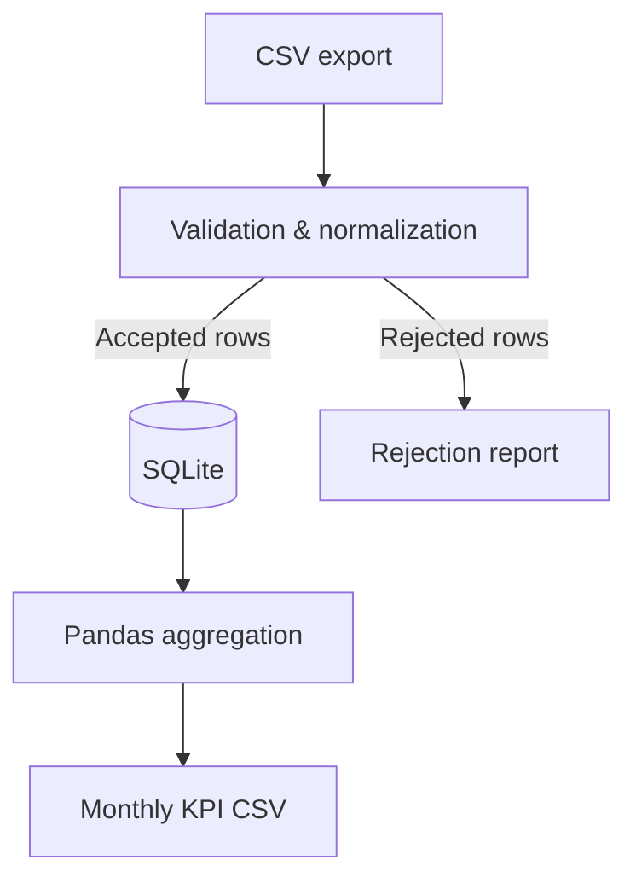

# RetailPulse — Python Data Pipeline 📊

## Live Dashboard

[**View Interactive Dashboard**](https://retailpulse-bernardo-demo.sunnyduck17.chatgpt.site)

Explore sales performance, revenue, orders, refunds, and data quality metrics through an interactive dashboard built from the pipeline's sample data.

**A compact, reproducible ETL pipeline that validates retail transactions, stores them in SQLite, and generates monthly sales analytics with Pandas.**

Built as an original portfolio project to demonstrate Python development, data cleaning, SQL, idempotent ingestion, automated testing, and practical business metrics.

> The sample dataset is entirely fictional. No private company data, credentials, or paid cloud services are needed.

## Highlights

- **Extract:** read transactional CSV exports with a documented input schema.
- **Transform:** normalize identifiers, dates, categories and status; validate rows; convert monetary values to **integer cents** using Python's `Decimal`.
- **Load:** write to SQLite, deduplicating transaction IDs in each file and updating corrected records on later imports.
- **Reject:** save invalid rows' numbers, IDs and explanations in a separate file, without copying raw customer records.
- **Analyze:** use Pandas to aggregate monthly gross revenue, refunds, net revenue, paid orders, units sold, and average order value.
- **Test:** automated unit and end-to-end tests with disposable local SQLite databases.
- **Automate:** GitHub Actions runs tests and the sample pipeline after every push.

## Architecture



## Quick start (Windows PowerShell)

**Requirements:** Python 3.11 or newer. Docker and MySQL are **not** needed.

Open this project folder in VS Code, then run:

```powershell
py -m venv .venv
.\.venv\Scripts\python.exe -m pip install -e ".[dev]"
.\.venv\Scripts\python.exe -m retailpulse demo
```

The last command creates the `output/demo/` folder with three files:

| File | Contents |
| --- | --- |
| `retailpulse.sqlite` | Normalized, queryable transaction database |
| `rejected_rows.csv` | Data-quality failures and explanations |
| `monthly_kpis.csv` | Monthly KPIs by country |

**Preview without running any code:** see the committed [KPI report](examples/monthly_kpis.csv) and [rejected-row report](examples/rejected_rows.csv).

Run it again to see idempotency: previously imported records become **unchanged**, not duplicated.

### Automated tests

```powershell
.\.venv\Scripts\python.exe -m pytest -q
```

On macOS/Linux, replace `py` with `python3` and use `.venv/bin/python` instead of `.venv\Scripts\python.exe`.

## CLI

Run the sample demo:

```bash
python -m retailpulse demo --output-dir output/demo
```

Ingest your own CSV:

```bash
python -m retailpulse ingest --input data/sample_sales.csv --db output/retailpulse.sqlite --rejects output/rejected_rows.csv
```

Generate an analysis report from an existing SQLite database:

```bash
python -m retailpulse report --db output/retailpulse.sqlite --output output/monthly_kpis.csv
```

## Input data contract

| CSV field | Example | Requirement |
| --- | --- | --- |
| `transaction_id` | `TX-001` | Unique per sale/refund event |
| `order_id` | `ORD-100` | Order identifier; may have multiple transactions |
| `customer_id` | `C-01` | Anonymous/customer reference |
| `ordered_at` | `2026-09-01` | ISO calendar date |
| `country` | `BR` | Two-letter code |
| `category` | `Electronics` | Text category |
| `quantity` | `2` | Positive integer (1–1000) |
| `unit_price_usd` | `99.90` | Positive decimal amount in USD (exact cents) |
| `status` | `PAID` | `PAID`, `REFUNDED` or `CANCELLED` |

**Interpretation:** `PAID` transactions add to gross revenue; `REFUNDED` transactions are subtracted from net revenue; `CANCELLED` transactions contribute no revenue. Refunded transactions use positive amounts and have their own transaction IDs. An order with multiple paid lines counts as **one paid order** when computing average order value.

## Example results

After running the included synthetic sample file, one row of the summary looks like this:

| Month | Country | Gross USD | Refunded USD | Net USD | Paid orders | Units sold | AOV USD |
| --- | --- | ---: | ---: | ---: | ---: | ---: | ---: |
| 2026-09 | BR | 130.90 | 99.90 | 31.00 | 2 | 3 | 65.45 |

The sample intentionally includes invalid prices and a duplicate transaction ID; these go to the rejection report rather than silently altering the KPIs.

## Important implementation decisions

1. **Idempotency:** reimporting the same CSV doesn't create duplicates. Later corrected versions update existing records by `transaction_id`.
2. **Money:** prices are checked with `Decimal` and stored as whole cents; no binary floating-point operations are used to persist money.
3. **Transactional safety:** accepted records are committed together. Unexpected file-shape errors trigger a database rollback.
4. **Rounding:** average order value is rounded half-up to the nearest cent using integer arithmetic.
5. **Data quality:** rejected rows get actionable error reasons, enabling investigation without losing the successfully validated records.
6. **Readable design:** input models, SQLite access, ingestion, reporting, and CLI are separate modules with tests.

## Project structure

```text
retailpulse/
  cli.py         # Command-line interface
  models.py      # Typed transaction model and validation
  database.py    # SQLite schema and idempotent persistence
  ingest.py      # CSV ingestion and rejected-row handling
  report.py      # Pandas metrics and CSV exports
data/
  sample_sales.csv   # Synthetic transactions
examples/              # Preview CSV reports, available directly on GitHub
tests/                # Unit and end-to-end tests
.github/workflows/    # Automated checks
```

## Future improvements

- Add an incremental ingestion checkpoint for large batches.
- Build a dashboard from the KPI exports.
- Introduce anomaly detection to flag unusual refund rates.
- Implement a scheduled pipeline with versioned migrations.

## License

MIT — see [LICENSE](LICENSE).
